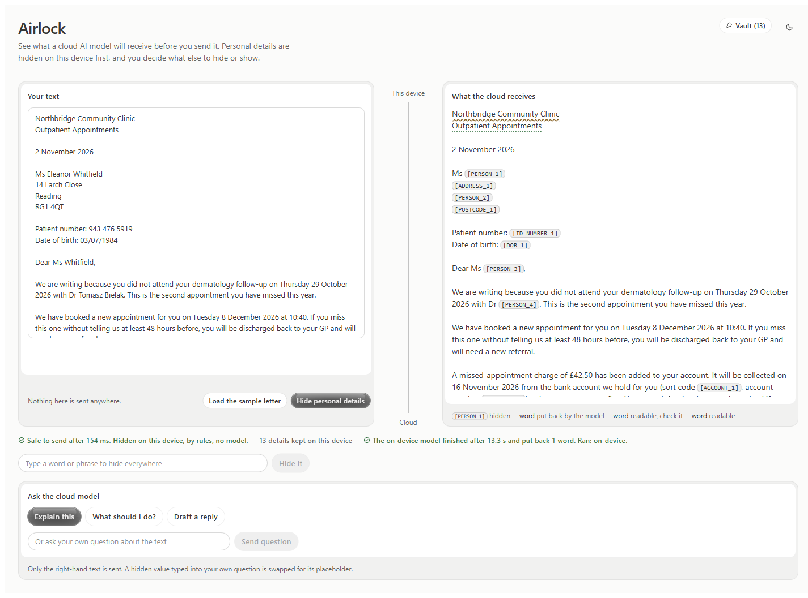

<p align="center">
  <picture>
    <source media="(prefers-color-scheme: dark)" srcset="assets/logo-dark.svg">
    
  </picture>
</p>

<h1 align="center">Airlock</h1>

<p align="center"><strong>See what a cloud model will receive before you send it.</strong></p>

Airlock sits between a private document and a cloud AI model. Personal details
are hidden on your device first, the cloud model works on placeholders, and the
real values are put back on your device when the answer returns.

It is a web app for Chrome, built on
[Firebase AI Logic](https://firebase.google.com/docs/ai-logic/hybrid) hybrid
inference, and an entry for the #BuildHybridAI 2026 hackathon. It is a proof of
concept, measured carefully. Read the limits before relying on it.

**Try it:** [firebase-airlock.vercel.app](https://firebase-airlock.vercel.app), in
desktop Chrome with the on-device model. No sign-in.



## How it works

1. **Hide first, in code.** Patterns and word lists hide everything that could
   be a personal detail. This takes 1 to 90 ms, and from then the text is safe
   to send.
2. **The on-device model puts useful words back.** Gemini Nano in Chrome, called
   through Firebase AI Logic in `ONLY_ON_DEVICE` mode, may only un-hide items it
   labels as medical or ordinary words. It cannot fall back to the cloud.
3. **You check.** Step 2 of the screen shows the exact outgoing text. Click any
   word to hide or show it.
4. **The cloud model answers** from placeholders such as `[PERSON_1]`. A leak
   check refuses to send if a hidden value is still readable.
5. **Real values are restored on your device** from a vault kept in this tab's
   memory. It is gone on reload.

Every model call goes through Firebase AI Logic. There is no other AI provider.

## Results

Share of the details that must be hidden that were hidden. Full method and
figures: [docs/final-results.md](docs/final-results.md).

| Text | Hidden | Interval | Runs |
|---|---|---|---|
| Fictional letters, `final-set` (46 documents, 481 details) | **97.1%** | about 95 to 98 | 5 |
| Fictional medical documents, written blind (20 documents, 206 details) | 99.3% | 96.5 to 99.9 | 5 |
| Synthetic outside text, Nemotron-PII (100 documents, 342 details) | 98.5% | 96.6 to 99.4 | 3 |
| Real court judgments, TAB (100 documents, 228 entities) | 96.1% | 92.7 to 97.9 | 3 |

On `final-set`, against thresholds fixed in advance:

| Measure | Threshold | Result |
|---|---|---|
| Subject's details hidden | 97% in every run | 97.1% mean; **missed** by one detail in two runs of five |
| Other people's details hidden | 95% | 181 of 181 in every run; pass |
| Useful facts kept | 90% | 92.7%; pass |
| Medical terms kept | 95% | 91.5%; **missed** |

Speed on one laptop with a GPU: safe to send after 1 to 90 ms; the on-device
model finishes a one-page letter in about 3 to 5 seconds.

### Known limits

- **It reduces what is shared. It does not remove every clue to who a person
  is.** A clinic name, a date or a town can still narrow it down.
- **A name that opens a sentence can leak** ("Amara's scan has been moved").
  Four of twelve trap names leak this way. This is the most concrete open leak.
- Names that are everyday words ("Hope", "Mark") standing alone, usernames,
  foreign phone formats, and dates that identify a person but are not labelled
  as a date of birth.
- **It over-hides.** On unseen medical documents about one medical term in
  eight was hidden. Text written all in capitals is safe but badly over-hidden.
- About 16 to 18 words a page stay underlined for you to check.
- English only. The patterns are UK-shaped.

### Not tested

- Any machine other than one laptop; any browser other than Chrome 157.
- Real documents other than court judgments.
- A machine with no usable GPU.
- The scrub with the machine's network switched off (it was tested with the
  page offline, and no request left during the scrub).
- Answer quality after the last design changes.
- Reading a photographed letter. The feature is switched off.

## Run it

You need desktop Chrome with the on-device model, and a free Firebase project.
[docs/setup.md](docs/setup.md) takes about 15 minutes.

```bash
npm install
cp env.example .env.local   # then fill it in; never commit it
npm run dev                 # app at /, benchmark at /eval.html
```

| Command | What it does |
|---|---|
| `npm test` | Unit tests for the core and the benchmark scoring |
| `npm run typecheck` | TypeScript, strict |
| `npm run lint` | The Glaze design-system lint on `src` |
| `npm run build` | Production build |
| `npm run eval` | The benchmark in a real Chrome, on fictional labelled letters |
| `npm run e2e` | One full run with network-level checks: no request during the scrub, no hidden value in the cloud request, no third-party origin |

The test scripts start Chrome with its own profile in `.chrome-profile/`.
Options are at the top of `scripts/chrome.mjs`.

## Where things are

- `src/airlock.ts`, `src/hidefirst.ts`, `src/suspects.ts` detect, redact, restore and the leak check. No Firebase or DOM imports.
- `src/models.ts` the only place models are created and called.
- `src/app/` the screen, in React on the Glaze design system.
- `src/eval/`, `eval.html`, `answers.html` the benchmark.
- `docs/` results, evaluation plan, datasets, word lists, related work, setup. Earlier round logs are in `docs/archive/`.

## Licence and credits

[Apache-2.0](LICENSE). Third-party material is listed in [NOTICE](NOTICE):

- [Glaze](https://github.com/arla6ka/design.how) design system, MIT.
- Word lists built from the US Census, the Office for National Statistics, the
  Central Statistics Office of Ireland, Wikidata, SCOWL and Google Books Ngram
  data. Details in [docs/wordlists.md](docs/wordlists.md).
- Measured with Nemotron-PII (NVIDIA, CC BY 4.0) and the Text Anonymization
  Benchmark (Norsk Regnesentral, MIT). Neither is in this repository.

Every letter, name and number in this repository is fictional.
